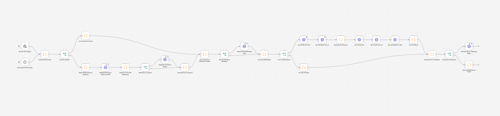

# n8n-hubspot-portal-configuration-snapshot-git-backup

> Automated disaster-recovery pipeline that exports HubSpot custom property schemas, pipeline stages, and workflow metadata to structured JSON and commits versioned diffs to a private Git repo.

An n8n workflow that takes a deterministic, checksummed snapshot of a HubSpot portal's **configuration** (not its records) and keeps a versioned history of it in a private Git repository. Every run produces sorted, canonical JSON. Every file and every record gets a SHA-256 hash, and a commit happens only when something actually changed, with a commit message that names the exact properties, pipelines, and workflows that moved.

It is **safe by default**. Imported as-is, the workflow runs against a synthetic fixture (portal `99000001`), makes zero network calls, and never commits.

---

## Contents

1. [What gets backed up](#1-what-gets-backed-up)
2. [Architecture overview](#2-architecture-overview)
3. [Prerequisites](#3-prerequisites)
4. [5-minute sandbox quick start](#4-5-minute-sandbox-quick-start)
5. [Step-by-step import and go-live](#5-step-by-step-import-and-go-live)
6. [Environment variables](#6-environment-variables)
7. [Backup schema structure](#7-backup-schema-structure)
8. [Diffs, versions and commit messages](#8-diffs-versions-and-commit-messages)
9. [Disaster-recovery restore guide](#9-disaster-recovery-restore-guide)
10. [Version control best practices](#10-version-control-best-practices)
11. [Safety matrix](#11-safety-matrix)
12. [Compliance checklist](#12-compliance-checklist)
13. [Troubleshooting](#13-troubleshooting)
14. [Repository layout](#14-repository-layout)
15. [Disclaimer and license](#15-disclaimer--liability-limitation)

---

## 1. What gets backed up

| Area | HubSpot endpoint | Snapshot file(s) |
|---|---|---|
| Custom object schemas (labels, display/required/searchable properties, associations) | `GET /crm/v3/schemas` | `custom-objects/schemas.json` |
| Custom object property definitions | included in the schemas response | `custom-objects/<name>/properties.json` |
| Property definitions (contacts, companies, deals, tickets, plus any you add) | `GET /crm/v3/properties/{objectType}` | `properties/<objectType>.json` |
| Property groups | `GET /crm/v3/properties/{objectType}/groups` | `property-groups/<objectType>.json` |
| Pipelines and stages (deals, tickets) | `GET /crm/v3/pipelines/{objectType}` | `pipelines/<objectType>.json` |
| Workflow metadata (ID, name, type, object type, enabled, revision, timestamps) | `GET /automation/v4/flows` (default) or `GET /automation/v3/workflows` | `workflows/workflows.json` |
| Portal guard (token-to-portal check) | `GET /account-info/v3/details` (optional) | not stored |

**Not backed up, by design:** CRM records, workflow actions and enrollment criteria, emails, forms, lists, reports, dashboards, users, teams and permissions. Workflow export is an **allowlist** of metadata fields, so action graphs, which can hold email bodies, owner assignments or personal data, never reach Git.

> **Why v4 for workflows?** HubSpot's `/automation/v3/workflows` endpoint only returns contact-based workflows. `/automation/v4/flows` covers every object type, including custom objects. Set `HUBSPOT_WORKFLOWS_API=v3` only if your portal cannot use v4.

---

## 2. Architecture overview

```mermaid
flowchart LR
    subgraph T["Triggers"]
        M["Manual Test Trigger"]
        S["Daily Snapshot Schedule<br/>cron 15 2 * * *"]
    end
    M --> C
    S --> C
    C["Config & Safety Gate<br/>env vars, fail-safe flags"] --> SB{"Sandbox Mode?"}

    SB -- "true (default)" --> FX["Load Synthetic Fixture<br/>portal 99000001, offline"]
    SB -- false --> BR["Build HubSpot Export Requests"]
    BR --> HX["HubSpot Metadata Export<br/>GET, batched, retry"]
    HX --> CV["Collect & Verify<br/>pairing + portal guard"]
    CV --> WS{"Workflows In Scope?"}
    WS -- true --> WX["HubSpot Workflows Export<br/>GET, paginated"]
    WS -- false --> AR
    WX --> AR["Assemble Raw Snapshot"]

    FX --> N["Normalization & Checksum Auditor<br/>scrub, sort, split, SHA-256, self-check"]
    AR --> N
    N --> RD{"Remote Diff Read Enabled?"}
    RD -- true --> PM["Fetch Previous Manifest<br/>GitHub GET"]
    RD -- false --> D
    PM --> D["Versioned Diff Builder<br/>file + record diff, commit gate"]
    D --> G{"Commit Gate Open?"}

    G -- "false (default)" --> DR["Dry-Run Preview"]
    G -- true --> R1["Git: Get Branch Ref"] --> R2["Git: Get Head Commit"] --> TP["Build Git Tree Payload"] --> R3["Git: Create Tree"] --> R4["Git: Create Commit"] --> R5["Git: Update Branch Ref<br/>force: false"] --> CR["Commit Result"]

    DR --> SUM["RevOps Summary Builder"]
    CR --> SUM
    SUM --> NE{"Notifications Enabled?"}
    NE -- true --> SL["Slack / Webhook Notify"]
    NE -- "false (default)" --> LOG["Run Log<br/>no external calls"]
```





### Node reference

| # | Node | Type | Purpose |
|---|---|---|---|
| 1 | Manual Test Trigger / Daily Snapshot Schedule | Trigger | Manual runs, or daily at 02:15 (instance time zone). The workflow ships **inactive**. |
| 2 | Config & Safety Gate | Code | Reads env vars and resolves fail-safe flags. Refuses live mode without a token and numeric portal ID. Outputs presence booleans, never secret values. |
| 3 | Sandbox Mode? | IF | Routes to the offline fixture (default) or the live read-only export. |
| 4 | Load Synthetic Fixture | Code | Embedded copy of `sample-payloads/portal-metadata-fixture.json`. |
| 5 | Build HubSpot Export Requests | Code | One GET request item per endpoint in scope. |
| 6 | HubSpot Metadata Export (v3 API) | HTTP | Batched 4 requests per 1.1 s, 3 retries, per-endpoint errors recorded instead of aborting. |
| 7 | Collect & Verify API Responses | Code | Re-pairs responses to requests and enforces the **portal guard**. |
| 8 | Workflows In Scope? → HubSpot Workflows Export | IF + HTTP | Paginated (`after` cursor, 50-page cap) workflow listing. |
| 9 | Assemble Raw Snapshot | Code | Merges workflow pages with CRM metadata. |
| 10 | Normalization & Checksum Auditor | Code | Scrubs volatile fields, sorts deterministically, splits into files, hashes per file, per record and per bundle, re-verifies, runs RevOps sanity checks. |
| 11 | Remote Diff Read Enabled? → Fetch Previous Manifest (Git) | IF + HTTP | Reads the last committed `manifest.json` (GET only). A 404 on the first run is expected. |
| 12 | Versioned Diff Builder | Code | File- and record-level diff, manifest lineage, commit message, commit gate. |
| 13 | Commit Gate Open? | IF | Opens only when every safety condition holds (see [Safety matrix](#11-safety-matrix)). |
| 14 | Git: Get Branch Ref → … → Commit Result | HTTP + Code | One **atomic** commit via the GitHub Git Data API (tree → commit → ref). `force: false` means a concurrent push fails safely. |
| 15 | Dry-Run Preview | Code | The exact commit that *would* be made, and every reason it was not. |
| 16 | RevOps Summary Builder | Code | Health, object counts, checksum status, change counts, commit link, and a Slack `{text, blocks}` payload. |
| 17 | Notifications Enabled? → Slack / Webhook Notify, or Run Log | IF + HTTP / Code | Posts only when explicitly enabled. Otherwise logs locally. |

---

## 3. Prerequisites

- **n8n** 1.x or later, self-hosted or cloud with env-var access. Set:
  - `N8N_BLOCK_ENV_ACCESS_IN_NODE=false`. Recent n8n releases block `$env` by default. If it stays blocked, the workflow **falls back to sandbox defaults** rather than failing open.
  - Optional: `NODE_FUNCTION_ALLOW_BUILTIN=crypto` to use native SHA-256. A bundled pure-JS SHA-256 gives byte-identical results, and the simulator verifies this.
- **Node.js 18+** to run the offline simulator. It has no npm dependencies.
- **HubSpot private app** in the portal you want to back up (a developer test account first).
- **Private Git repository** on GitHub or GitHub Enterprise, with a dedicated snapshot branch.
- Optional: a **Slack incoming webhook** or any endpoint that accepts `{ "text", "blocks" }` JSON.

### Required HubSpot private app scopes (read-only)

| Scope | Used for |
|---|---|
| `crm.schemas.custom.read` | `GET /crm/v3/schemas` (custom object schemas and their properties) |
| `crm.schemas.contacts.read` | Contact properties and property groups |
| `crm.schemas.companies.read` | Company properties and property groups |
| `crm.schemas.deals.read` | Deal properties, property groups and deal pipelines |
| `crm.objects.deals.read` | Deal pipelines (HubSpot accepts either this or the schema scope for some pipeline endpoints) |
| `tickets` (or `crm.schemas.tickets.read`) | Ticket properties, groups and ticket pipelines |
| `automation` | Workflow listing (`/automation/v4/flows` or `/automation/v3/workflows`) |

> ⚠️ **There is no `automation.read` scope.** HubSpot's single `automation` scope grants read **and write** access to workflows. Mitigations built into this repository:
> - Every HubSpot HTTP node is hard-wired to `GET`, and the simulator fails if that ever changes.
> - Create a **dedicated** private app used only by this workflow, and do not reuse its token elsewhere.
> - If workflow metadata is not essential, set `EXPORT_WORKFLOWS=false` and leave `automation` off the app.
>
> HubSpot lists several alternative scopes per endpoint and changes them over time. If an endpoint returns `403 MISSING_SCOPES`, the run is marked **DEGRADED**, the failing endpoint is named in the summary, and the scope list on HubSpot's endpoint reference page is authoritative.

### GitHub token

Use a **fine-grained personal access token** (or a GitHub App installation token) restricted to **one** repository with **Contents: Read and write** and **Metadata: Read**. Nothing else is needed.

---

## 4. 5-minute sandbox quick start

**Step 1. Run the offline simulator (no n8n, no network, about 2 seconds).**

```bash
git clone <your-private-copy-of-this-repo>
cd n8n-hubspot-portal-configuration-snapshot-git-backup
node scripts/simulate-sandbox-run.js
```

The simulator extracts the JavaScript of every Code node from `workflow.json` and runs it in an isolated VM with **no** `http`, `https`, `net` or `fetch`. It runs 89 checks covering structure, safe defaults, live-mode refusals, fixture parity, SHA-256 engines (including NIST vectors), determinism, record-level diffs, the live path against mocked HubSpot responses, and the commit path against mocked GitHub responses. It ends with:

```
✅ 89 passed, 0 failed
Snapshot bundle sha256: f83e41197eb6e46a0b02fee7f15d26152273269b775b8530fc243f80eaa85b0a
Output written to: sim-output/ (git-ignored)
```

Look at `sim-output/snapshots/portal-99000001/` to see exactly what the Git repo will contain, and at `sim-output/dry-run-preview.json` and `sim-output/summary.json`. Verify the checksums yourself:

```bash
cd sim-output/snapshots/portal-99000001 && sha256sum -c SHA256SUMS
```

**Step 2. Import into n8n.** In n8n, go to **Workflows → Import from File** and select `workflow.json`. No credentials are needed.

**Step 3. Execute.** Open the workflow and click **Test workflow**. With no env vars set, the path is: Config → Sandbox Mode? (true) → Load Synthetic Fixture → Normalization → Diff → Commit Gate (false) → Dry-Run Preview → Summary → Run Log. Open **Dry-Run Preview** to read the commit that would be made and the list of reasons it was blocked.

---

## 5. Step-by-step import and go-live

Go live in three stages. Each stage changes exactly one safety switch.

### Stage A: live read, no Git (validates scopes)

1. Create the private app in a **developer test account or sandbox portal** with the scopes above. Copy the token into your secret store, never into the workflow.
2. Set:
   ```bash
   SANDBOX_MODE=false
   HUBSPOT_ACCESS_TOKEN=<from secret store>
   HUBSPOT_PORTAL_ID=<numeric hub id of the TEST portal>
   # DRY_RUN stays true, GIT_COMMITS_ENABLED stays false
   ```
3. Restart n8n so it picks up the env, then run manually. Check that **Collect & Verify** shows no `endpointErrors`, that the portal guard passed, and that the health status is `HEALTHY`.

### Stage B: live read plus remote diff, still dry-run

1. Create a private repo and a dedicated branch, for example `hubspot-config-snapshots`. The branch must exist, because the workflow updates refs and does not create branches:
   ```bash
   git switch --orphan hubspot-config-snapshots
   git commit --allow-empty -m "chore: initialise HubSpot config snapshot branch"
   git push -u origin hubspot-config-snapshots
   ```
2. Set `GITHUB_PAT`, `GITHUB_REPOSITORY=owner/repo`, `GIT_BRANCH`, and `GIT_REPO_URL`.
3. Run. **Fetch Previous Manifest** returns 404 (`git-first-run`), and the Dry-Run Preview should now list only `DRY_RUN=true` and `GIT_COMMITS_ENABLED is not true` as blockers.

### Stage C: arm commits

1. Set `DRY_RUN=false` and `GIT_COMMITS_ENABLED=true`. Run manually once and confirm the commit in the repo.
2. Run again. It should report `NO_CHANGES` and make no commit.
3. Change one property label in the test portal and run again. You should get one commit that names the property.
4. Optionally set `NOTIFICATIONS_ENABLED=true` and `SLACK_WEBHOOK_URL`.
5. **Activate** the workflow so the schedule runs. Repeat stages A to C for the production portal with a separate token and, ideally, a separate repo or folder.

Also configure an n8n **Error Workflow** in workflow settings. Git write nodes stop the run on failure, so you get alerted instead of a silent partial run.

---

## 6. Environment variables

| Variable | Default | Description |
|---|---|---|
| `SANDBOX_MODE` | `true` | **Safe-ON.** Offline synthetic fixture and synthetic portal ID. Turns off only on `false`, `0`, `no` or `off`. |
| `DRY_RUN` | `true` | **Safe-ON.** Builds the commit but never writes. |
| `GIT_COMMITS_ENABLED` | `false` | **Safe-OFF.** Turns on only on `true`, `1`, `yes` or `on`. |
| `NOTIFICATIONS_ENABLED` | `false` | **Safe-OFF.** Posts the summary to `SLACK_WEBHOOK_URL`. |
| `HUBSPOT_ACCESS_TOKEN` | — | Private app token. Required in live mode. Used only inside HTTP header expressions. |
| `HUBSPOT_PORTAL_ID` | — | Numeric Hub ID. Required in live mode. Ignored in sandbox mode, where `99000001` is forced. |
| `HUBSPOT_API_BASE_URL` | `https://api.hubapi.com` | API host. |
| `HUBSPOT_WORKFLOWS_API` | `v4` | `v4` (all object types) or `v3` (contact-based only). |
| `VERIFY_PORTAL_ID` | `true` | Cross-checks the token's portal against `HUBSPOT_PORTAL_ID`. A mismatch stops the run; an unreadable endpoint records a warning. |
| `EXPORT_CUSTOM_OBJECTS` | `true` | Export custom object schemas and their properties. |
| `EXPORT_PROPERTIES` | `true` | Export property definitions. |
| `EXPORT_PROPERTY_GROUPS` | `true` | Export property groups. |
| `EXPORT_PIPELINES` | `true` | Export pipelines and stages. |
| `EXPORT_WORKFLOWS` | `true` | Export workflow metadata. Needs the `automation` scope. |
| `EXPORT_OBJECT_TYPES` | `contacts,companies,deals,tickets` | Object types for properties and groups. |
| `EXPORT_PIPELINE_OBJECT_TYPES` | `deals,tickets` | Object types for pipelines. |
| `EXPORT_HUBSPOT_DEFINED_PROPERTIES` | `false` | Include HubSpot's built-in properties. This adds noise but gives a full inventory. |
| `STRIP_VOLATILE_TIMESTAMPS` | `true` | Drop `updatedAt` from CRM metadata so touch-only edits don't produce commits. Workflow `updatedAt` is always kept. |
| `REDACT_USER_IDS` | `true` | Drop `createdUserId`, `updatedUserId`, `createdByUserId` and `updatedByUserId`. |
| `GITHUB_PAT` | — | Fine-grained token for one repo. |
| `GITHUB_REPOSITORY` | — | `owner/repo`. A URL is rejected. |
| `GIT_REPO_URL` | — | Human-facing URL, used for commit links in the summary. |
| `GITHUB_API_BASE_URL` | `https://api.github.com` | Set to `https://<host>/api/v3` for GitHub Enterprise Server. |
| `GIT_BRANCH` | `hubspot-config-snapshots` | Target branch. Must exist. |
| `GIT_PROTECTED_BRANCHES` | `main,master,production` | Branches the workflow refuses to write to. |
| `GIT_ALLOW_PROTECTED_BRANCH` | `false` | Override for the rule above (not recommended). |
| `GIT_SNAPSHOT_ROOT` | `snapshots` | Folder inside the repo. Files go to `<root>/portal-<id>/`. |
| `GIT_REMOTE_DIFF_ENABLED` | `true` | Read the previous manifest from Git in live mode. |
| `GIT_PRUNE_REMOVED_FILES` | `false` | Delete snapshot files no longer produced. This only applies on `HEALTHY` runs. |
| `GIT_COMMIT_ON_DEGRADED` | `false` | Allow commits when some endpoints failed. Failed files are never pruned. |
| `GIT_COMMIT_AUTHOR_NAME` / `GIT_COMMIT_AUTHOR_EMAIL` | bot identity | Commit author. |
| `COMMIT_MESSAGE_MAX_RECORD_NAMES` | `15` | Record names listed per file in the commit message. |
| `SLACK_WEBHOOK_URL` | — | Incoming webhook. |
| `NOTIFY_CHANNEL_LABEL` | `#revops-alerts` | Informational label. |
| `SNAPSHOT_TIMESTAMP_OVERRIDE` | — | Pins the timestamp for reproducible tests. |
| `N8N_BLOCK_ENV_ACCESS_IN_NODE` | n8n default | Must be `false` for env-driven config. |
| `NODE_FUNCTION_ALLOW_BUILTIN` | — | Optional `crypto` for native hashing. |

### Sample `.env`

```bash
# Stage A: live read-only export of a TEST portal, no Git writes
N8N_BLOCK_ENV_ACCESS_IN_NODE=false
NODE_FUNCTION_ALLOW_BUILTIN=crypto
GENERIC_TIMEZONE=UTC

SANDBOX_MODE=false
DRY_RUN=true
GIT_COMMITS_ENABLED=false
NOTIFICATIONS_ENABLED=false

HUBSPOT_ACCESS_TOKEN=<injected-from-secret-manager>
HUBSPOT_PORTAL_ID=99000001
HUBSPOT_WORKFLOWS_API=v4

GITHUB_PAT=<injected-from-secret-manager>
GITHUB_REPOSITORY=example-org/hubspot-config-backup
GIT_REPO_URL=https://github.example/example-org/hubspot-config-backup.git
GIT_BRANCH=hubspot-config-snapshots
```

The complete template, with every variable, is in [`.env.example`](.env.example).

---

## 7. Backup schema structure

```
snapshots/
└── portal-99000001/
    ├── manifest.json                      # versions, checksums, record hashes, lineage
    ├── SHA256SUMS                         # `sha256sum -c` compatible
    ├── custom-objects/
    │   ├── schemas.json                   # schemas without their property arrays
    │   └── vendor_contract/
    │       └── properties.json
    ├── properties/
    │   ├── companies.json
    │   ├── contacts.json
    │   ├── deals.json
    │   └── tickets.json
    ├── property-groups/
    │   └── <objectType>.json
    ├── pipelines/
    │   ├── deals.json                     # pipelines with stages ordered by displayOrder
    │   └── tickets.json
    └── workflows/
        └── workflows.json                 # allowlisted metadata only
```

### Determinism rules

| Rule | Detail |
|---|---|
| Key order | Every object's keys are sorted at every depth. |
| Record order | Properties and groups by `name`; schemas by `objectTypeId`; pipelines and stages by `displayOrder`, then `id`; workflows and associations by numeric `id`. |
| Option order | Enumeration options by `value`. `displayOrder` is kept as a field, so UI order can still be restored. |
| Formatting | 2-space JSON, UTF-8, trailing newline. |
| Scrubbing | `updatedAt` (CRM metadata only) and user-ID fields are removed by default. |

The same configuration therefore always produces the same bytes. The simulator proves this by reversing every array, changing volatile timestamps and the run time, and confirming the bundle checksum doesn't change.

### `manifest.json` (abridged)

```json
{
  "bundleSha256": "2f827550bfe5e3295f7922a3b1cd01311ea82315ef86ef4540159e0d0c0d5a85",
  "capturedAt": "2026-11-18T02:15:00.000Z",
  "counts": { "customObjects": 1, "pipelineStages": 14, "pipelines": 3, "properties": 17, "propertyGroups": 12, "workflows": 4 },
  "files": {
    "properties/deals.json": {
      "bytes": 3384,
      "kind": "properties",
      "objectType": "deals",
      "recordHashes": {
        "deal_tier": "b5aeee7adec18c79",
        "forecast_commit_override": "159944fedbbb8812",
        "meddpicc_champion_identified": "092ccd23fb86a72a",
        "renewal_risk_score": "ae3c17238526a95f",
        "weighted_amount_calc": "b754362adeb7f1fd"
      },
      "records": 5,
      "sha256": "277264bfa7868245750849c8ff673cd0c3f8232adb945d5bec92f64221627150"
    }
  },
  "hashAlgorithm": "sha256",
  "health": "HEALTHY",
  "lineage": {
    "previousBundleSha256": "f83e41197eb6e46a0b02fee7f15d26152273269b775b8530fc243f80eaa85b0a",
    "previousSnapshotVersion": "v20261117T021500Z",
    "previousSource": "git"
  },
  "portalId": "99000001",
  "schemaVersion": "1.0.0",
  "snapshotVersion": "v20261118T021500Z"
}
```

### Checksums

- **File checksum:** `sha256(file bytes)`.
- **Record hash:** the first 16 hex characters of `sha256(canonical JSON of one record)`. This enables record-level diffs without downloading old files.
- **Bundle checksum:** `sha256(SHA256SUMS)`, a single fingerprint for the whole configuration.
- **Self-check:** every file is re-parsed, re-serialised and re-hashed before anything leaves the node. Any mismatch marks the run `FAILED` and blocks the commit.
- **Chain:** each manifest records the previous bundle checksum, so tampering or gaps in history are detectable.

---

## 8. Diffs, versions and commit messages

Each run compares the new snapshot with the last committed `manifest.json`. Files are classified as added, modified, removed or unchanged. Modified files are then diffed **per record** using `recordHashes`. Example commit, generated by the simulator:

```
chore(snapshot): portal-99000001 v20261118T021500Z [+0 ~2 -0]

Bundle:   sha256:2f827550bfe5e3295f7922a3b1cd01311ea82315ef86ef4540159e0d0c0d5a85
Previous: sha256:f83e41197eb6e46a0b02fee7f15d26152273269b775b8530fc243f80eaa85b0a
Health:   HEALTHY | records: 37 | hash engine: node:crypto
Run:      snap-20261118021500-jbqbm0 (synthetic-fixture)

Changes:
~ pipelines/deals.json | changed: 99100001
~ properties/deals.json | added: renewal_risk_score | changed: deal_tier

Warnings (1):
- properties/companies: enumeration "arr_band" has no options
```

- **Versions:** `snapshotVersion` (`vYYYYMMDDTHHMMSSZ`) identifies each snapshot. Git history is the version store; tag milestones yourself (see §10).
- **Removed files** are shown with `!` and kept in the repo unless `GIT_PRUNE_REMOVED_FILES=true` *and* the run is `HEALTHY`. A missing file usually means a narrowed export scope or a failed endpoint, not a deleted configuration.
- **No changes, no commit.** Re-runs on an unchanged portal report `NO_CHANGES`.

---

## 9. Disaster-recovery restore guide

There is **no automated restore.** Restores write to your CRM and must be reviewed by a person. Use a **separate** private app with the matching *write* scopes, never the backup token, and rehearse every procedure on a test portal first.

### 9.1 Find and verify the snapshot

```bash
git clone --branch hubspot-config-snapshots <private-repo-url> hs-backup && cd hs-backup
git log --oneline -- snapshots/portal-<id>/                      # history
git log -S'"name": "deal_tier"' -- snapshots/portal-<id>/properties/deals.json   # when it changed
git checkout <commit> -- snapshots/portal-<id>/                  # pick a point in time
cd snapshots/portal-<id> && sha256sum -c SHA256SUMS               # verify integrity
sha256sum SHA256SUMS                                              # must equal manifest.bundleSha256
```

### 9.2 Compare backup against the live portal (read-only)

Run the workflow with `DRY_RUN=true`. The Dry-Run Preview and commit message list every record that differs from the last committed snapshot. Or compare one file:

```bash
git diff <good-commit> <bad-commit> -- snapshots/portal-<id>/pipelines/deals.json
```

### 9.3 Restore a deleted or damaged property

```bash
# Extract one definition and drop read-only / server-managed fields.
jq '.[] | select(.name=="deal_tier")
    | del(.createdAt, .updatedAt, .archived, .hubspotDefined, .calculated,
          .modificationMetadata, .externalOptions)' \
  snapshots/portal-<id>/properties/deals.json > /tmp/deal_tier.json

# Review /tmp/deal_tier.json, then create (POST) or update (PATCH) it.
curl -sS -X POST "https://api.hubapi.com/crm/v3/properties/deals" \
  -H "Authorization: Bearer ${HUBSPOT_RESTORE_TOKEN}" \
  -H "Content-Type: application/json" --data @/tmp/deal_tier.json
# For an existing property: PATCH /crm/v3/properties/deals/deal_tier (omit "name" and "type")
```

Restore the **property group** first if it is also missing (`property-groups/<objectType>.json` → `POST /crm/v3/properties/{objectType}/groups`). Calculated properties may need their formula re-entered in the UI.

### 9.4 Restore a pipeline or stages

```bash
jq '.[] | select(.id=="99100001") | {label, displayOrder,
     stages: [.stages[] | {label, displayOrder, metadata}]}' \
  snapshots/portal-<id>/pipelines/deals.json > /tmp/pipeline.json
curl -sS -X POST "https://api.hubapi.com/crm/v3/pipelines/deals" \
  -H "Authorization: Bearer ${HUBSPOT_RESTORE_TOKEN}" \
  -H "Content-Type: application/json" --data @/tmp/pipeline.json
```

> Recreated pipelines and stages get **new IDs**. Existing records, reports and workflows that pointed at the old IDs must be remapped. Fix a renamed stage with `PATCH /crm/v3/pipelines/{objectType}/{pipelineId}/stages/{stageId}` whenever possible, rather than recreating it.

### 9.5 Restore a custom object

1. Rebuild the schema from `custom-objects/schemas.json` plus `custom-objects/<name>/properties.json` (custom properties only), then `POST /crm/v3/schemas`.
2. Re-create associations listed in the schema's `associations`.
3. A new custom object gets a new `objectTypeId`. Update every integration and workflow that referenced the old one.

### 9.6 Workflows

Only metadata is stored. Use `workflows/workflows.json` as the **inventory and checklist**: which workflows existed, their object type, whether they were on, and their revision. Rebuild logic from HubSpot's own workflow version history or your process documentation, then compare the live list against the snapshot to confirm nothing is missing.

### 9.7 After any restore

Run the workflow in dry-run mode. The diff against the last good snapshot should only show the IDs and timestamps you expect to change.

---

## 10. Version control best practices

- **Private repo, dedicated branch.** Keep snapshots on `hubspot-config-snapshots` (never `main`). Protect it so that only the bot identity can push, and require linear history.
- **Least-privilege tokens.** A fine-grained PAT for one repo with Contents read/write, or a GitHub App. Set an expiry and rotate it.
- **Tag milestones.** Before a major portal change, such as a migration, a pipeline redesign or a new integration:
  `git tag -a pre-migration-2026-11 -m "Known-good config" <sha> && git push --tags`
- **One folder per portal.** `snapshots/portal-<id>/` lets production and test portals share a repo without colliding. Separate repos give stronger isolation.
- **Review diffs.** Route commit notifications to RevOps. An unexpected `~ pipelines/deals.json` is often the earliest sign of an unapproved change.
- **Keep history.** Don't squash or force-push the snapshot branch. The manifest's lineage chain relies on it.
- **Mirror the repo.** Keep a second remote or a periodic `git bundle` offsite, so a lost Git host isn't a lost backup.
- **Treat the workflow as code.** Keep `workflow.json` changes in this repo, run `node scripts/simulate-sandbox-run.js` in CI, and re-import after review.

---

## 11. Safety matrix

| Control | Default | Effect when default | To change |
|---|---|---|---|
| `SANDBOX_MODE` | `true` | Synthetic fixture, synthetic portal ID, **zero network calls** | `false` (explicit) |
| `DRY_RUN` | `true` | Commit built and previewed, never written | `false` (explicit) |
| `GIT_COMMITS_ENABLED` | `false` | Commit gate closed | `true` (explicit) |
| `NOTIFICATIONS_ENABLED` | `false` | Summary logged locally only | `true` + `SLACK_WEBHOOK_URL` |
| Workflow `active` | `false` | Schedule does not fire after import | Activate in n8n |
| HubSpot HTTP method | `GET` | No CRM mutation is possible | Not configurable |
| Blocked `$env` | — | Falls back to all safe defaults | `N8N_BLOCK_ENV_ACCESS_IN_NODE=false` |
| Typo in a flag | — | Treated as the safe value | Use `true` / `false` |
| Missing token or portal ID in live mode | — | Run refused with a clear error | Set both |
| Portal guard | on | Token from another portal stops the run | `VERIFY_PORTAL_ID=false` |
| Protected branches | `main,master,production` | Commits refused | `GIT_ALLOW_PROTECTED_BRANCH=true` |
| Health `FAILED` | — | Commit always blocked | Fix the cause |
| Health `DEGRADED` | — | Commit blocked | `GIT_COMMIT_ON_DEGRADED=true` |
| Unreadable previous manifest (not 404) | — | Commit blocked (no blind diffs) | Fix Git access |
| No changes | — | No commit | — |
| Pruning | `false` | Missing files kept | `GIT_PRUNE_REMOVED_FILES=true` (HEALTHY runs only) |
| Ref update | `force: false` | Concurrent pushes fail safely | Not configurable |
| Secrets in item data | never | Only presence booleans leave the config node | — |
| Workflow export | allowlist | No action logic or message content | Not configurable |

---

## 12. Compliance checklist

- [ ] The backup repository is **private**, with access limited to named people and the bot identity.
- [ ] The HubSpot private app is dedicated to this workflow, has read scopes only (plus `automation` if workflows are exported), and its token lives only in the secret store or n8n env.
- [ ] The team understands that `automation` is a read/write scope, and the app's owner is recorded.
- [ ] The GitHub token is fine-grained, limited to one repo, has an expiry date and is on a rotation schedule.
- [ ] Configuration metadata has been reviewed for personal data. Property labels, descriptions, picklist values, and pipeline or workflow names sometimes contain names or emails. Rename them in HubSpot, or narrow the export scope.
- [ ] `REDACT_USER_IDS=true` is kept unless you have a documented reason to store HubSpot user IDs.
- [ ] Data residency and retention requirements for the Git host are confirmed (GDPR/CCPA, contracts, internal policy).
- [ ] Stages A to C were completed on a **test portal** before production.
- [ ] A **restore drill** (§9) has been performed on a test portal and documented.
- [ ] An n8n Error Workflow alerts the owner when a run fails.
- [ ] Commit notifications are monitored and unexpected changes are investigated.
- [ ] `node scripts/simulate-sandbox-run.js` passes after every change to `workflow.json`.
- [ ] The run schedule respects HubSpot API rate limits alongside your other integrations.

---

## 13. Troubleshooting

| Symptom | Likely cause and fix |
|---|---|
| Every run stays in sandbox mode despite `SANDBOX_MODE=false` | `$env` is blocked. Set `N8N_BLOCK_ENV_ACCESS_IN_NODE=false` and restart n8n. The config output shows `envBlocked: true`. |
| `Live mode (SANDBOX_MODE=false) refused` | `HUBSPOT_ACCESS_TOKEN` is missing or `HUBSPOT_PORTAL_ID` is not numeric. |
| Endpoint error `403 MISSING_SCOPES` | Add the scope listed in §3 to the private app. The token stays the same after scope changes, but some apps require reinstalling. |
| Workflows error mentioning `workflows-access-public-api` | The portal's tier or the user's permissions do not expose the Workflows API. Set `EXPORT_WORKFLOWS=false` or upgrade access. |
| Only contact workflows appear | `HUBSPOT_WORKFLOWS_API=v3`. Switch to `v4`. |
| `Portal guard: the HubSpot token belongs to portal …` | Wrong token for this portal. Fix the env. |
| `Git: Get Branch Ref` 404 | The branch doesn't exist. Create it (Stage B, step 1). |
| `Git: Update Branch Ref` 422 | Someone pushed to the branch during the run. Re-run; `force: false` prevented an overwrite. |
| `Previous manifest could not be read (git-unavailable)` | PAT lacks Contents read, wrong repo or branch, or a GitHub outage. The commit is blocked on purpose. |
| Manifest larger than 1 MB | The GitHub Contents API stops returning inline content above 1 MB. Narrow `EXPORT_OBJECT_TYPES`, or keep `EXPORT_HUBSPOT_DEFINED_PROPERTIES=false`. |
| Commit every run with no visible changes | Usually a HubSpot field that changes on read. Check the commit's `changed:` list and the diff. If it is a timestamp-like field, add it to `VOLATILE_KEYS` in the Normalization node and re-run the simulator. |
| Workflow list truncated warning | More than 50 pages (5,000 workflows). Raise **Max Pages** on the Workflows Export node and `maxWorkflowPages` in the Config node together. |

---

## 14. Repository layout

```
.
├── workflow.json                         # n8n workflow (29 nodes, inactive on import)
├── README.md
├── DISCLAIMER.md
├── LICENSE
├── .env.example
├── .gitignore
├── sample-payloads/
│   └── portal-metadata-fixture.json      # synthetic HubSpot metadata (portal 99000001)
└── scripts/
    └── simulate-sandbox-run.js           # offline simulator, zero dependencies
```

---

## 15. ⚠️ Disclaimer & Liability Limitation

**Use at your own risk.** The code, workflows, and scripts in this repository (**n8n-hubspot-portal-configuration-snapshot-git-backup**) are provided for educational and architectural demonstration purposes.

**No Liability:** The author and dhRobin Systems accept no responsibility or liability for any direct, indirect, incidental, or consequential damages that result from using, misusing, or deploying these scripts, including incomplete or corrupted backups, failed restores, lost CRM configuration, or overwritten Git history.

**No Warranty:** All software, n8n JSON blueprints, JavaScript modules, and sample payloads are provided "AS IS", without warranty of any kind, express or implied. This includes, but is not limited to, warranties of merchantability, fitness for a particular purpose, and non-infringement.

**Not a Complete Disaster-Recovery Solution:** Only configuration metadata is exported. CRM records, workflow logic, and many other portal assets are not. Restores are manual and must be reviewed by a person.

**Production Testing Required:** Always test thoroughly in an isolated staging environment, such as a HubSpot developer test account or sandbox and a throwaway private Git repository, with `SANDBOX_MODE=true` and `DRY_RUN=true` enabled, before you connect live HubSpot or Git credentials. Review the Dry-Run Preview before enabling commits, and rehearse a restore before relying on any snapshot.

**Third-Party APIs & Compliance:** You alone are responsible for complying with the terms of service, rate limits, data privacy regulations (GDPR/CCPA), and security policies of HubSpot, GitHub (or any Git host), Slack, n8n, and any connected services. That includes keeping the backup repository private, scoping and rotating tokens, recognising that the `automation` scope also grants write access, keeping personal data out of committed metadata, and reviewing every automatically created commit.

The full disclaimer is also available in [DISCLAIMER.md](DISCLAIMER.md).

## License

Released under the MIT License. Copyright (c) 2026 DH Robin (dhRobin Systems). See [LICENSE](LICENSE).

---

Full text: DISCLAIMER.md · Licensed under the MIT License. License: MIT © 2026 DH Robin (dhRobin Systems) · Provided as-is, see the disclaimer.
